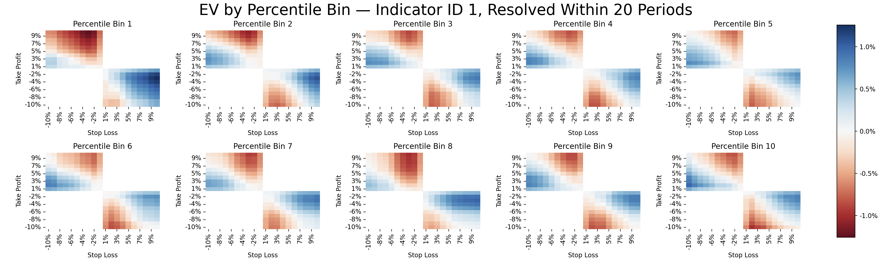

# EV Engine
Quantifies the expected value of a trade, given a market state and a risk-reward ratio, with a specified time horizon. Calculated empirically using conditional probabilities with historical OHLCV data from Binance. 

The project is the formalised build of the EV engine developed in [algotrader-playground](https://github.com/jctaylor11/algotrader-playground).

The core question it answers is, "What is the empirical probability that a A% profit is hit before a B% loss, within a holding period - given the current market state". Currently, market state is defined by endogenous values (price-derived indicators such as RSI). More usefully, market state could be define by exogenous real-world data, which can carry information the price doesn't yet reflect.

For example, if return A is a take-profit (e.g. +5%), and return B is a stop-loss (e.g. −3%), then for the specified market conditions it will calculate the probability that A is hit before B, within the holding period. The risk-reward ratio would be 3:5. The expected value would be calculated as follows, and expressed per dollar invested at entry price.

```
EV = |A| · P(A before B) − |B| · P(B before A) 
```

The output is a heatmap showing the empirical expected value for each trade setup. There is one heatmap for each market state (currently, each percentile bin of one indicator). The market state is categorised into percentile bins. For example, the EV for each 10th percentile bin, conditioned on the RSI indicator only as the market state:




## Usage

1. Install dependencies with `pip install -r requirements.txt`.
2. Copy `.env.example` to `.env` and add your PostgreSQL database's connection details.
3. Select Binance ticker, candle interval, and date range in `config/config.toml`.
4. Run each step as a module from the repo root:

```bash
python -m pipelines.create_tables      # Creates the database tables
python -m pipelines.populate_tables    # Fetches raw OHLCV data, for each candle computes outcomes and RSI
python -m pipelines.ev_contingency     # Compute EVs and plot the heatmaps
```

`ev_contingency` opens three heatmaps in turn: unconditional EV, conditional EV for a single percentile bin, and a grid of all percentile bins. The next one loads when the one before is closed. 
 

## Folders
Each folder is a module for a stage in the pipeline. 

1. **Ingestion**:     Fetches OHLCV candles from Binance public API in rate-limited batches in DataFrame
2. **Database**:      PostgreSQL connection and schema, and loads candles from DataFrame to database.
3. **Indicators**:    Computes state for each candle in SQL - in this case RSI.
4. **Outcomes**:      Computes outcomes from each candle, in terms of candles until each return threshold is hit.
5. **Analysis**:      Calculates the probability of each outcome, for each indicator percentile bin, and EV.
6. **Visualisation**: Plots EV heatmaps, one per indicator percentile bin.


## Outcomes Table

Results are derived from candle outcomes. The outcomes table characterises the subsequent market performance onwards from each candle within ±10%, defined by how many candles it took to first hit a given return threshold. It calculates this for all returns within the configured scope (±10% with 1% gradations). 

The important information here is the *sequence* of returns, where ultimately the only thing I care about is "Did the price hit a positive A% return (my take-profit) before it hit a negative B% return (my stop-loss)". These two levels are what defines my risk-reward ratio too. It doesn't matter what path the price takes - only in what sequence the two thresholds are hit. This is what the table communicates, and is necessary in order to count instances of A hit before B, which will be conditioned on state (such as indicator values).

A known limitation is if both thresholds are hit within the same candle. In this case, it's gives no information on wich outcome was hit first. This becomes increasingly common with higher timeframe views. 
