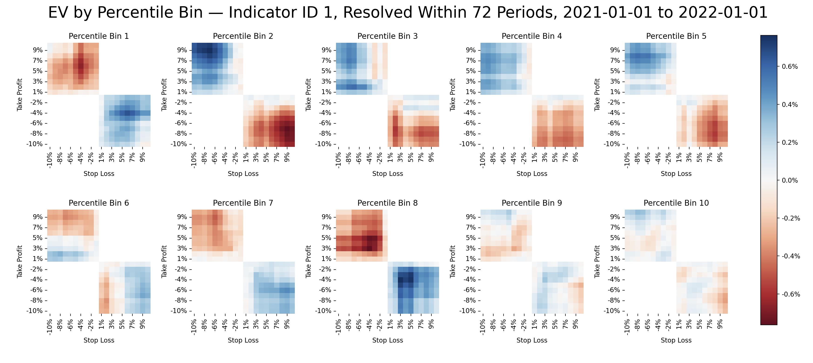

# EV Engine

Computes the empircal expected value (EV) for every trade setup conditional on market state, within a tolerated holding period. It pulls historical OHLCV data from Binance using the public API, hence no API key is needed.

This project was inspired by how a casino maintains its edge through EV. Work on this originally started in my [algotrader-playground](https://github.com/jctaylor11/algotrader-playground) repo, and was formalised here.

The core question it answers is, "What is the empirical probability that an A% profit is hit before a B% loss, given the current market state, within my tolerated holding period". Currently, market state is defined by endogenous values (price-derived indicators such as RSI). More usefully, market state could be defined by exogenous real-world data, which can carry information the price doesn't yet reflect.

## Example

For example, if return A is a take-profit (e.g. +5%), and return B is a stop-loss (e.g. −3%), what is empirical probability that A is hit before B, given the specified market conditions and tolerated holding period (e.g. 72 periods)? In this case, the risk-reward ratio would be 3:5. This is repeated for every setup, and the EV for each is presented as a heatmap.

The EV would be calculated as follows, and expressed per dollar invested at entry price (adjusted for trades that go unresolved, and closed at the end of the holding period)

```
EV = |A| · P(A before B) − |B| · P(B before A) + (average return of unresolved trade) * P(unresolved)
```

An unresolved trade is one where neither threshold was hit within the holding period. In this case, the EV is corrected by adding the average of the unresolved returns at the end of the holding period (for that A and B combination) multiplied by the proportion of instances where a trade goes unresolved. 

The output is a heatmap showing the empirical expected value for each trade setup. There is one heatmap for each market state (currently, each percentile bin of one indicator). The market state is categorised into percentile bins. For example, the EV for every RSI percentile bin, using BTCUSDT 1h candles for 2021 and a 72-candle holding period:



Interestingly, based on this data a long position in the first bin is almost always negative expected value, whereas a long position in the second bin with a generous stoploss is clearly positive expected value. With a tight stop, the expected value is pretty much zero. It seems the most oversold RSI values favour momentum strategies more than mean reversion. 

Evidently, a tight stop has a very low absolute expected value, likely as it's more subject to market noise. In some cases it seems giving very wide stops lowers the expected value - likely since one loses control with a greater chance of the trade closing as a result of being unresolved by the setup. 

 Note that these results are over a full year, whereas more usefully results are considered dependent on the market regime.

The results from this tool can be used to suggest strategy ideas - for example, recomputing the heatmap on each new candle using data up until that point, and taking positions with an expected value above a threshold value.

## Usage

1. Install dependencies with `pip install -r requirements.txt`.
2. Copy `.env.example` to `.env` and add your PostgreSQL database's connection details.
3. Select desired Binance ticker, candle interval, and date range in `config/config.toml`.
4. Run each step as a module from the repo root:

```bash
python -m pipelines.create_tables      # Creates the database tables
python -m pipelines.populate_tables    # Fetches raw OHLCV data, for each candle computes outcomes and RSI
python -m pipelines.ev_contingency     # Compute EVs and plot the heatmaps
```

`ev_contingency` opens three heatmaps in turn: unconditional EV, conditional EV for a single percentile bin, and a grid of all percentile bins. The next one loads when the one before is closed. 
 

## Pipeline Stages
Each folder is a module for a stage in the pipeline. 

1. **Ingestion**:     Fetches OHLCV candles from Binance public API in rate-limited batches into a DataFrame.
2. **Database**:      PostgreSQL connection and schema, and loads candles from DataFrame to database.
3. **Indicators**:    Computes state for each candle in SQL - in this case RSI.
4. **Outcomes**:      Computes outcomes from each candle, in terms of candles until each return threshold is hit.
5. **Analysis**:      Calculates the probability of each outcome, for each indicator percentile bin, and EV.
6. **Visualisation**: Plots EV heatmaps, one per indicator percentile bin.


## Outcomes Table

Outcomes are core component to the model since results are derived from them. The outcomes table characterises the subsequent market performance onwards from each candle within ±10%, defined by how many candles it took to first hit a given return threshold. It calculates this for all returns within the configured scope (±10% with 1% gradations). 

The important information here is the *sequence* of returns, where ultimately the only thing I care about is "Did the price hit a positive A% return (my take-profit) before it hit a negative B% return (my stop-loss)". These two levels are what defines my risk-reward ratio too. It doesn't matter what path the price takes - only in what sequence the two thresholds are hit. This is what the table communicates, and is necessary in order to count instances of A hit before B, which will be conditioned on state (such as indicator values).

A known limitation is if both thresholds are hit within the same candle. In this case, it's gives no information on which outcome was hit first. This becomes increasingly common with higher timeframe views. 

## Key Design Considerations

### Probability Space

There are four possible outcomes. Each contributes differently to the EV: 

1. **A is hit first**, within the holding period: Return is +|A|
2. **B is hit first**, within the holding period: Return is -|B|
3. **Unresolved** - neither is hit within the holding period: Return is return at end of holding period
4. **Same candle** - A and B are both hit within the same candle: Return is 0 (unknown)

These outcomes are mutually exclusive and collectively exhaustive. This was verified by seeing all four counts matches the sum of candles in the bin. The EV is the proportion-weighted average.

Base rate neglect was avoided by using the number of *all* candles in the bin as the denominator, to ensure it was relative to every trade entered, regardless of whether or not it resolves. 

### Null values

Null values were considered carefully, since there are several different instances a null arises, and context can give information on what that instance is:
- If B is null yet A is hit, then evidently A was hit first. Thus, holding period is only relevant for the first threshold to hit.
- If both A and B are null, the trade is classified as unresolved.
- Recent nulls (last few candles) are just because the price hasn't had time, whereas nulls from long ago meaningfully signal the level was never hit. In the case of the former, unresolved trades count as 0.

### Complements not taken

I originally considered computing only half the table and deriving P(B before A) as 1 − P(A before B). However this would be wrong, since it would count unresolved and same-candle trades as B first. This would especially overestimate for wider thresholds or shorter holding periods, where more trades go unresolved. Both sides are calculated directly. 

### Same candle hits

Same candle hits are included in the denominator to avoid base-rate neglect, but the return is taken as 0. It's impossible to know which threshold was hit first without more granular data. The impact is that some data points are lost, but the inegrity remains, albeit both P(A before B) and P(B before A) are both understated.

## Future Scope

### Exogenous State

The current form only considers individual endogenous indicator state. Since these are derived from price data, there is arguably little signal - it's effectively technical analysis. Future scope would be to pull data from exeternal sources independent of price, for example, processing data from blockchain wallet transactions and conditioning outcomes on that.

### Combined State

Currently, each indicator conditions the outcome independently - e.g, the EV for RSI bin 1. It would be good to consider multiple states and condition outcomes on the combination. This would create more a 'fingerprint' of market state. The results are also regime-dependent, so this could be factored in too. However, would need to be cautious of the number of candles in each combination of bins shrinking such to make the data meaningless, the 'curse of dimensionality'.

### EV-threshold Strategy

The heatmaps could be turned into a trading strategy by recomputing the heatmaps at every new candle, and taking any setup with an EV above a given threshold. In backtest, there'd need to be a close attention to lookahead bias - it would need to be recalculated each candle using only historical data up to that point.